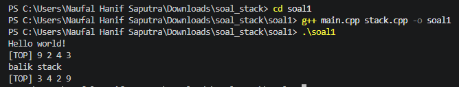
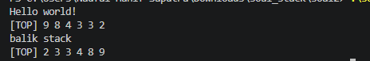
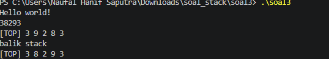

# <h1 align="center">Laporan Praktikum Modul 7 Stack</h1>
<p align="center">Naufal Hanif Saputra - [109082500209]</p>

## Dasar Teori
Stack adalah struktur data linear yang cara kerjanya mengikuti prinsip LIFO (Last In First Out): elemen yang paling akhir dimasukkan menjadi elemen yang pertama kali diambil. Pada C++, stack bisa direpresentasikan dengan array ditambah satu variabel penanda posisi elemen teratas (top). Operasi dasarnya meliputi Push() untuk menyisipkan elemen ke puncak stack, pop() untuk mengambil elemen puncak, dan printInfo() untuk mencetak isi stack. Pada modul ini terdapat pula operasi tambahan, yaitu pushAscending() yang menyisipkan elemen sambil menjaga urutan naik, getInputStream() yang membaca deretan angka dari keyboard, dan balikStack() yang membalik posisi seluruh elemen.

## Guided 

### 1. Stack.h

```C++
/* file : stack.h
   contoh ADT stack dengan representasi tabel */
#ifndef STACK_H_INCLUDED
#define STACK_H_INCLUDED

#include <iostream>
using namespace std;

struct infotype {
    char nim[20];
    char nama[20];
};
struct Stack {
    infotype info[10];
    int Top;
};

/* prototype */
/******** pengecekan apakah Stack kosong *********/
int isEmpty(Stack S);
/* mengembalikan nilai 0 jika stack kosong */

/******** pembuatan Stack ********/
void createStack(Stack &S);
/* I.S. sembarang
   F.S. terbentuk stack dengan Top=0 */

/******** penambahan elemen pada Stack ********/
void push(Stack &S, infotype X);
/* I.S. Stack mungkin kosong
   F.S. menambahkan elemen pada stack dengan nilai X, TOP=TOP+1 */

/******** penghapusan elemen pada Stack ********/
void pop(Stack &S, infotype &X);
/* I.S. stack tidak kosong
   F.S. nilai info pada indeks TOP disimpan pada X, kemudian TOP=TOP-1 */

/******** proses semua elemen Stack *********/
void viewStack(Stack S);
/* I.S. stack mungkin kosong
   F.S. jika stack tidak kosong menampilkan semua info yang ada pada stack
*/
#endif // STACK_H_INCLUDED
```

### 2. Stack.cpp

```C++
#include "stack.h"

int isEmpty(Stack S) {
    /* Top = 0 berarti kosong, sesuai komentar di stack.h dikembalikan 0 */
    if (S.Top == 0) {
        return 0;
    } else {
        return 1;
    }
}

void createStack(Stack &S) {
    S.Top = 0;
}

void push(Stack &S, infotype X) {
    if (S.Top < 10) {
        S.Top = S.Top + 1;
        S.info[S.Top - 1] = X;   /* Top 1..10 dipetakan ke indeks array 0..9 */
    } else {
        cout << "Stack penuh, data tidak bisa ditambahkan" << endl;
    }
}

void pop(Stack &S, infotype &X) {
    if (isEmpty(S) != 0) {
        X = S.info[S.Top - 1];
        S.Top = S.Top - 1;
    } else {
        cout << "Stack kosong, tidak ada data yang bisa diambil" << endl;
    }
}

void viewStack(Stack S) {
    if (isEmpty(S) == 0) {
        cout << "Stack kosong" << endl;
    } else {
        cout << "Isi stack (dari TOP):" << endl;
        for (int i = S.Top; i >= 1; i--) {
            cout << i << ". " << S.info[i - 1].nim << " - "
                 << S.info[i - 1].nama << endl;
        }
    }
}
```

### 3. main.cpp

```C++
#include <iostream>
#include <cstring>
#include "stack.h"
using namespace std;

int main() {
    Stack S;
    infotype data, hasil;

    createStack(S);
    cout << "Stack baru dibuat, Top = " << S.Top << endl;
    viewStack(S);

    cout << endl << "--- Push 3 data ---" << endl;
    strcpy(data.nim, "103112400001");
    strcpy(data.nama, "Andi");
    push(S, data);

    strcpy(data.nim, "103112400002");
    strcpy(data.nama, "Budi");
    push(S, data);

    strcpy(data.nim, "103112400003");
    strcpy(data.nama, "Citra");
    push(S, data);
    viewStack(S);

    cout << endl << "--- Pop 1 data ---" << endl;
    pop(S, hasil);
    cout << "Data yang diambil: " << hasil.nim << " - " << hasil.nama << endl;
    viewStack(S);

    cout << endl << "--- Pop sampai kosong ---" << endl;
    pop(S, hasil);
    pop(S, hasil);
    pop(S, hasil);
    viewStack(S);

    return 0;
}
```

## Unguided 

### 1. 

### Stack.h

```C++

#ifndef STACK_H
#define STACK_H

typedef int infotype;

struct Stack {
    infotype info[20];
    int top;
};

void createStack(Stack &S);
void Push(Stack &S, infotype x);
infotype pop(Stack &S);
void printInfo(Stack S);
void balikStack(Stack &S);

#endif
```

### Stack.cpp
```C++
#include "stack.h"
#include <iostream>
using namespace std;

void createStack(Stack &S) {
    S.top = -1;
}

void Push(Stack &S, infotype x) {
    if (S.top < 19) {
        S.top++;
        S.info[S.top] = x;
    }
}

infotype pop(Stack &S) {
    if (S.top == -1) {
        return -1;
    }

    infotype x = S.info[S.top];
    S.top--;

    return x;
}

void printInfo(Stack S) {
    cout << "[TOP]";

    for (int i = S.top; i >= 0; i--) {
        cout << " " << S.info[i];
    }

    cout << endl;
}

void balikStack(Stack &S) {
    int awal = 0;
    int akhir = S.top;

    while (awal < akhir) {
        infotype temp = S.info[awal];
        S.info[awal] = S.info[akhir];
        S.info[akhir] = temp;

        awal++;
        akhir--;
    }
}
```

### main.cpp
```C++

#include <iostream>
#include "stack.h"
using namespace std;

int main() {
    cout << "Hello world!" << endl;

    Stack S;

    createStack(S);

    Push(S, 3);
    Push(S, 4);
    Push(S, 8);

    pop(S);

    Push(S, 2);
    Push(S, 3);

    pop(S);

    Push(S, 9);

    printInfo(S);

    cout << "balik stack" << endl;

    balikStack(S);

    printInfo(S);

    return 0;
}
```
### Output Unguided 1 :

##### Output 1



Pada soal 1, isi stack dibentuk dan dikurangi secara bertahap menggunakan Push() dan pop(). Karena sifat LIFO, setiap pemanggilan pop() selalu membuang elemen yang paling akhir masuk. Rangkaian operasi pada soal menghasilkan isi akhir 9, 2, 4, 3 (dibaca dari TOP). Setelah itu balikStack() menukar elemen paling awal dengan elemen paling akhir, lalu bergerak ke tengah, sehingga tampilannya berubah menjadi 3, 4, 2, 9 sesuai gambar soal.

### 2. 

### Stack.h

```C++
#ifndef STACK_H
#define STACK_H

typedef int infotype;

struct Stack {
    infotype info[20];
    int top;
};

void createStack(Stack &S);
void Push(Stack &S, infotype x);
infotype pop(Stack &S);
void printInfo(Stack S);
void balikStack(Stack &S);
void pushAscending(Stack &S, infotype x);

#endif
```

### Stack.cpp
```C++

#include "stack.h"
#include <iostream>
using namespace std;

void createStack(Stack &S) {
    S.top = -1;
}

void Push(Stack &S, infotype x) {
    if (S.top < 19) {
        S.top++;
        S.info[S.top] = x;
    }
}

infotype pop(Stack &S) {
    if (S.top == -1) {
        return -1;
    }

    infotype x = S.info[S.top];
    S.top--;

    return x;
}

void printInfo(Stack S) {
    cout << "[TOP]";

    for (int i = S.top; i >= 0; i--) {
        cout << " " << S.info[i];
    }

    cout << endl;
}

void balikStack(Stack &S) {
    int awal = 0;
    int akhir = S.top;

    while (awal < akhir) {
        infotype temp = S.info[awal];
        S.info[awal] = S.info[akhir];
        S.info[akhir] = temp;

        awal++;
        akhir--;
    }
}

void pushAscending(Stack &S, infotype x) {
    if (S.top < 19) {
        int i = S.top;

        while (i >= 0 && S.info[i] > x) {
            S.info[i + 1] = S.info[i];
            i--;
        }

        S.info[i + 1] = x;
        S.top++;
    }
}

void getInputStream(Stack &S) {
    char x;

    while (cin.get(x) && x != '\n') {
        if (x >= '0' && x <= '9') {
            Push(S, x - '0');
        }

        if (S.top == 19) {
            break;
        }
    }
}
```

### main.cpp
```C++

#include <iostream>
#include "stack.h"
using namespace std;

int main()
{
    cout << "Hello world!" << endl;

    Stack S;

    createStack(S);

    pushAscending(S, 3);
    pushAscending(S, 4);
    pushAscending(S, 8);
    pushAscending(S, 2);
    pushAscending(S, 3);
    pushAscending(S, 9);

    printInfo(S);

    cout << "balik stack" << endl;

    balikStack(S);

    printInfo(S);

    return 0;
}
```
### Output Unguided 2 :

##### Output 1



Soal 2 menambahkan prosedur pushAscending(). Berbeda dari Push() biasa yang selalu menaruh data di puncak, prosedur ini menggeser ke atas elemen yang nilainya lebih besar dari data baru, lalu menempatkan data baru pada posisi yang tepat. Dengan cara ini isi array selalu terurut naik dari dasar sampai puncak. Hasil tampilannya [TOP] 9 8 4 3 3 2 karena elemen terbesar berada di puncak, dan setelah dipanggil balikStack() urutannya menjadi 2 3 3 4 8 9.

### 3. 

### Stack.h

```C++

#ifndef STACK_H
#define STACK_H

typedef int infotype;

struct Stack {
    infotype info[20];
    int top;
};

void createStack(Stack &S);
void Push(Stack &S, infotype x);
infotype pop(Stack &S);
void printInfo(Stack S);
void balikStack(Stack &S);
void pushAscending(Stack &S, infotype x);
void getInputStream(Stack &S);

#endif
```

### Stack.cpp
```C++

#include "stack.h"
#include <iostream>
using namespace std;

void createStack(Stack &S) {
    S.top = -1;
}

void Push(Stack &S, infotype x) {
    if (S.top < 19) {
        S.top++;
        S.info[S.top] = x;
    }
}

infotype pop(Stack &S) {
    if (S.top == -1) {
        return -1;
    }

    infotype x = S.info[S.top];
    S.top--;

    return x;
}

void printInfo(Stack S) {
    cout << "[TOP]";

    for (int i = S.top; i >= 0; i--) {
        cout << " " << S.info[i];
    }

    cout << endl;
}

void balikStack(Stack &S) {
    int awal = 0;
    int akhir = S.top;

    while (awal < akhir) {
        infotype temp = S.info[awal];
        S.info[awal] = S.info[akhir];
        S.info[akhir] = temp;

        awal++;
        akhir--;
    }
}

void pushAscending(Stack &S, infotype x) {
    if (S.top < 19) {
        int i = S.top;

        while (i >= 0 && S.info[i] > x) {
            S.info[i + 1] = S.info[i];
            i--;
        }

        S.info[i + 1] = x;
        S.top++;
    }
}


void getInputStream(Stack &S) {
    char x;

    while (cin.get(x) && x != '\n') {
        if (x >= '0' && x <= '9') {
            if (S.top < 19) {
                Push(S, x - '0');
            }
        }
    }
}
```

### main.cpp
```C++

#include <iostream>
#include "stack.h"
using namespace std;

int main()
{
    cout << "Hello world!" << endl;

    Stack S;

    createStack(S);

    getInputStream(S);

    printInfo(S);

    cout << "balik stack" << endl;

    balikStack(S);

    printInfo(S);

    return 0;
}
```

### Output Unguided 3 :

##### Output 1


Soal 3 memakai getInputStream() untuk membaca input karakter demi karakter dengan cin.get() sampai tombol Enter ditekan. Hanya karakter '0' sampai '9' yang diproses: nilai angkanya didapat dengan mengurangkan karakter '0', lalu dimasukkan lewat Push(), dan pengecekan S.top < 19 menjaga agar stack tidak melebihi 20 elemen. Sebagai contoh, input 38293 ditampilkan sebagai [TOP] 3 9 2 8 3, kemudian menjadi 3 8 2 9 3 setelah dibalik dengan balikStack().

## Kesimpulan
Dari ketiga percobaan, saya memahami bahwa ADT Stack dengan array bekerja dengan satu penunjuk top yang menandai elemen teratas. Percobaan pertama melatih penggunaan Push() dan pop() beserta efek LIFO-nya, percobaan kedua memperkenalkan pushAscending() untuk menjaga data tetap terurut, dan percobaan ketiga memakai getInputStream() agar data bisa dimasukkan langsung dari keyboard sampai Enter ditekan.

Fungsi pendukung seperti printInfo() untuk menampilkan isi stack dan balikStack() untuk membalik urutan elemen membantu saya melihat hasil setiap operasi dengan jelas. Dari sini saya melihat bahwa semua fungsi stack saling terhubung lewat satu struktur data yang sama, dan prinsip LIFO menjadi dasar dari seluruh cara kerjanya.

## Referensi
[1] Weiss, M. A. (2014). Data Structures and Algorithm Analysis in C++ (4th ed.). Pearson.<br>
[2]Lippman, S. B., Lajoie, J., & Moo, B. (2012). C++ Primer (5th ed.). Addison-Wesley Professional.<br>
[3] cppreference.com. C++ Language: Arrays. https://en.cppreference.com/w/cpp/language/array<br>
[4] cppreference.com. std::basic_istream::get. https://en.cppreference.com/w/cpp/io/basic_istream/get<br>
